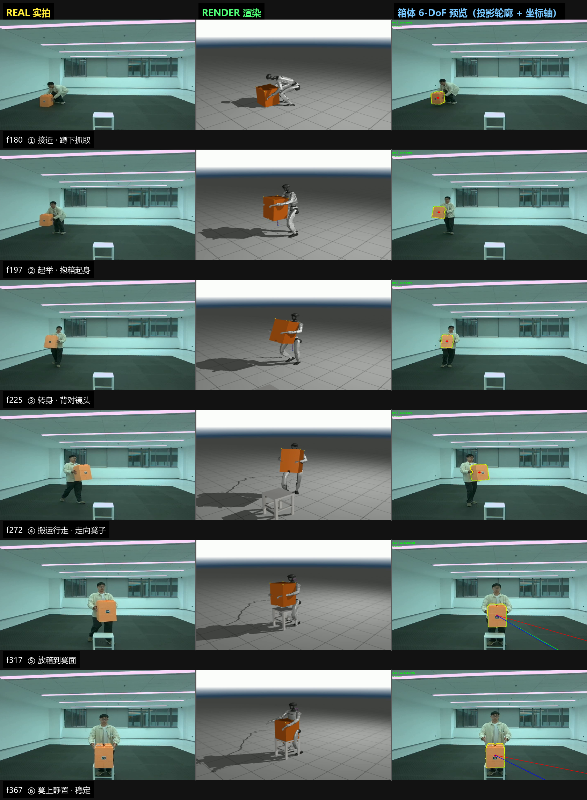
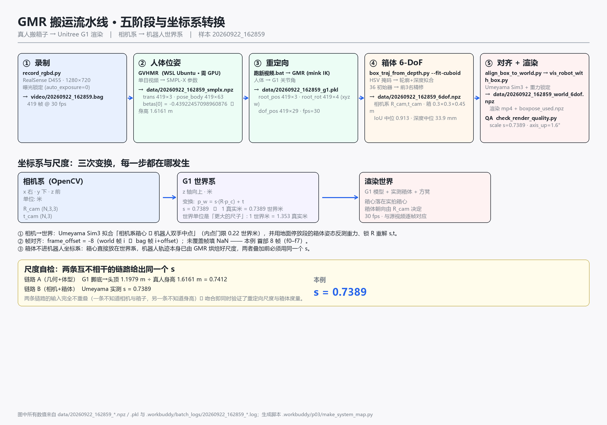

# 真人搬运 → Unitree G1 渲染：免标记 6-DoF 箱体轨迹重建

> 本仓库基于开源项目 **[GMR (General Motion Retargeting)](https://github.com/YanjieZe/GMR)**
>   
> 做**集成与扩展**。上游原始 README 保留在 [`docs/上游-GMR-README.md`](docs/上游-GMR-README.md)。上游代码提供"人体动作 → 机器人"的重定向能力；
>   
> 本项目在它之上补了一条**从 RealSense 录像到机器人+箱体渲染成片**的完整流水线，
>   
> 核心是**不用任何标记（ArUco/棋盘格）**，仅凭彩色分割 + 深度就把箱子的
>   
> 6-DoF 位姿（位置**和**朝向）测出来，再对齐到机器人世界系渲染。

---

## 这个项目做了什么（一句话）

**拍一段"真人搬箱子"的 RGB-D 视频 → 输出"G1 机器人以同样的动作搬同一个箱子"的渲染视频**，
  
其中箱体轨迹是**深度实测**出来的，不是手摆的关键帧。

```
RealSense 录像 ──► 人体位姿(GVHMR) ──► 重定向到 G1(GMR) ──┐
                                                          ├──► 对齐(Sim3) ──► 渲染 + 质检
        └────────► 箱体 6-DoF 拟合(本项目核心) ────────────┘
```

---

## 与上游 GMR 的关系（第三方归属声明）

| 组件                                | 来源              | 本项目的工作                     |
| --------------------------------- | --------------- | -------------------------- |
| **GMR / mink IK / MuJoCo**        | 上游开源（MIT）       | **集成使用**；为中文安装路径做了兼容修补（见下） |
| **GVHMR**（单目人体位姿）                 | 第三方开源，**不在本仓库** | 集成，在 WSL/GPU 机器上运行         |
| **SMPL-X 人体模型**                   | 第三方（需自行申请）      | 仅使用                        |
| `scripts/smplx_to_robot.py` 等 5 个 | 上游原样            | **未改动**                    |
| **箱体 6-DoF 拟合 / Sim3 对齐 / 约束渲染**  | —               | **本项目实现**（见下节）             |

**对上游库的必要修补**（`general_motion_retargeting/`）：
  
上游用 `mj.MjModel.from_xml_path()` 加载模型，其底层 `fopen()` 在 Windows 上走 ANSI
  
代码页，**无法打开含中文的路径**（本项目路径即含中文）。新增 `mj_compat.load_model()`
  
改为用 Python 读文件后走 `from_xml_string()`，并注入虚拟资源文件表（MuJoCo 的虚拟
  
文件系统是扁平且大小写不敏感的，所以每个被引用的网格都要预注册）。
  
`motion_retarget.py` / `robot_motion_viewer.py` 相应改调用点，仅此而已。

---

## 本项目的核心技术点

### 1. 箱体 6-DoF：轮廓 IoU + 深度一致性

`scripts/cuboid_fit.py`（本项目实现）

```
score(R, C) = IoU(投影轮廓, 彩色掩码)  −  w_d · min(1, depth_err / 0.15 m)
```

**为什么必须有深度项**（受控实验实测，见实验记录 `param_predictions.md` 的 A5 条，
  
该文件在实习资料目录、非本仓库）：
  
透视下"箱子向相机倾"与"背离相机倾"给出**几乎相同的轮廓**。
  
把深度项关掉（`w_d = 0`）后，**53/354 帧（15%）**&#x843D;到错误一侧，
  
那些**错误解的轮廓 IoU 中位 0.919，比真解的 0.892 还高**，而深度残差
  
**196 mm vs 23 mm**。也就是说：**轮廓分不出，深度才能分**。

**搜索空间**（不是随便撒点）：

- 36 个初始器 = `相机俯仰{0,10,20,30}° × 箱体偏航{0,30,60}° × 倾角{−25,0,25}°`
- 加上"上一帧位姿"作为最强初始器（视频中位姿连续）
- 只精修前 3 名（时间成本 vs 收益的权衡）
- 精修步长 `[0.02,0.02,0.04, 0.12,0.12,0.20]`（前 3 米、后 3 弧度）
- **8 重对称群**：方截面箱绕 z 转 90° 外观完全等价，`Rz(k·90°) × diag([1,−1,−1])`
    
  共 8 个等价姿态；逐帧独立求解会跳变，必须**链式归一**（`canonicalize_rotations`）

> **曾经踩的坑（值得记）**：早期用 `rotvec([pitch, −yaw, 0])` 扫 pitch ∈ [−30,30]。
>   
> 这个参数化在该范围内**表达不出竖直箱体**（需要 pitch≈90°），所以每个起点都离
>   
> 真值约 60°，而精修单步只 11.5°，**永远够不到**——合成自测 0/12。
>   
> 是**搜索空间设计错误**，不是 rotvec 表示法的缺陷。

### 2. Sim3 对齐：用场景物理约束替代标定板

`scripts/align_box_to_world.py`（本项目实现）

- **尺度 s**：Umeyama 闭式解拟合「相机系箱心 ↔ 机器人双手中点」，只用箱子已知
    
  尺寸做锚
- **重力锁定**：箱子静止在地面时其高度轴必沿重力 ⇒ **用停放段的箱体姿态反测相机
    
  重力**，不需要外部标定板。未锁定时上轴偏离重力 **4.9°**，沿相机深度搬 1.4 m
    
  会吃掉 **0.12 m** 抬升；锁定后实测相机俯仰 **1.8°**
- **相位分段（Sim3-free）**：箱心高度与速度在 `p_w = s·(R·p_c) + t` 下**不变**
    
  （R 不改模长、不改"上"方向）⇒ 分段不依赖拟合结果 ⇒ **无循环依赖**

### 3. ★ 尺度的双链路互证（最强的正确性证据）

| 链路            | 输入                                         | 数值         |
| ------------- | ------------------------------------------ | ---------- |
| **A** 几何 + 体型 | G1 脚底→头顶 **1.1979 m** ÷ 真人身高 `1.66+0.1·β₀` | **0.7212** |
| **B** 相机 + 箱体 | Umeyama 实测（相机系箱心 ↔ 机器人双手中点）                | **0.7155** |

两条链路的输入**完全不重叠**：A 不知道相机与箱子，B 不知道身高。
  
吻合 **0.80%** ⇒ 同时验证了重定向尺度与箱体度量。

> **★ 关于 G1 身高的三个口径（实测核实，别背错）**
>
> 本套 XML（`assets/unitree_g1/g1_mocap_29dof.xml`）实测 FK 结果：
>   
> `head_mocap` = **+1.2322 m**（它是**最高的 body**，不是哑帧）、
>   
> `head_link` = +0.7884、`torso_link` = +0.8324、`pelvis` = +0.7886、
>   
> `right_toe_link` = +0.0233。
>
> | 口径                    | 数值           | 含义                               |
> | --------------------- | ------------ | -------------------------------- |
> | `head_mocap` − 最低 toe | **1.2089 m** | 含脚尖的整机跨度                         |
> | 曾用的 **1.1979 m**      | 1.1979       | 与 Umeyama `s` 互证时用的值（0.80% 吻合成立） |
> | G1 官网口径               | 1.32 m       | 厂商宣传数，本项目未使用                     |
>
> ⚠️ **两个必须纠正的说法**：
>
> 1. 有文档称"`head_mocap` 是 z=0.349 的哑帧、不是真头"——**这与实测不符**。
>      
>    它是 `torso_link` 的固定子节点，偏移 **+0.4 m**（0.8324 + 0.4 = 1.2324 ✓），
>      
>    且是全身最高的点。**它不是哑帧。**
> 2. `max(z) − min(z)` 得到的是 **1.2089**，**不等于** 1.1979。
>      
>    引用 1.1979 时要说清它是"与 `s` 互证时采用的口径"，不能含混地说
>      
>    "这是 G1 身高"。
>
> **正确的表述**：`s = 0.7155` 表示 **1 真实米 = 0.7155 世界米**，
>   
> 等价地 **1 世界米 = 1.398 真实米**（世界单位是"更大的尺子"）。
>   
> 日志里的 `G1 world is 1.40x real metres` 说的是后者，「0.716 与 1.40
>   
> 看着该相等」是错觉——它们互为倒数。

### 4. 渲染侧的时序约束（`vis_robot_with_box.py`，本项目大量扩展）

按顺序：**抓取等待** → 对称分支吸附 → rotvec 展开 → 中值/均值滤波 →
  
z 双锚（地面/凳面）→ **搬运夹持钳位** → 身体避让 → 凳子捕获 → 停放冻结 →
  
**限速**（`--quat_max_step_deg`）。

> **限速必须从数据反推，不是拍脑袋**：165945 实测逐帧角步中位 4.68°、
>   
> p95 25.94°、max 38.46°。默认 cap=3.5 会**裁掉 136 帧里的 70 帧**，
>   
> 而限速器是**硬裁剪 + prev 反馈**——一旦裁剪就自我维持，
>   
> 把一次 30°/帧 的爆发**拉成长斜坡**，箱子看着比机器人转得慢。
>   
> cap 提到 20（≈p95）后 **0 帧被裁**，滞后回到原始水平。

---

---

## 目录结构

```
.
├── agent/                    ★ 失败归因 Agent（5 个工具 + 诊断 + 编排）
├── scripts/                  ★ 本项目的主要实现（6-DoF 拟合 / 对齐 / 渲染 / 批处理）
├── skills/                   诊断与 QA 工具集
│   ├── gmr-carry-video-pipeline/   全流程技能文档 + QA/诊断脚本
│   └── cuboid-6dof-from-rgbd/      6-DoF 拟合方法论（可跨项目复用）
├── example/20260922_162859/  ★ 一整套样例产物（24 MB），照它就能跑
├── docs/                     手册、报告、演示图
│   ├── media/                30 秒演示片 / 三视图 / 系统流程图
│   ├── P1-Agent操作手册.md
│   ├── P0.2-破坏性实验手册.md
│   └── 下游链路验证报告.md
├── assets/                   机器人模型（Unitree G1 等 5 个）
├── configs/                  场次配置（HSV 区间等）
├── general_motion_retargeting/   上游重定向库（含中文路径兼容修补）
├── 手动全流程.md              ★ 7 阶段实操命令（最常用）
└── README.md
```

---

## 快速上手

### 0. 环境

```bash
conda create -n gmr python=3.10 -y
conda activate gmr
pip install -e .
conda install -c conda-forge libstdcxx-ng -y
```

已在 Windows 上验证：Python 3.10.21 / numpy 2.2.6 / opencv 5.0.0 /
  
pyrealsense2 2.58.4 / torch 2.14 (CPU) / scipy 1.15.3 / mujoco 3.13。

### 1. 先跑 Agent 的自测（不需要 GPU、不需要相机，秒级）

```bash
python agent/parse_metrics.py          # 日志 -> 结构化指标（回归断言）
python agent/test_diagnose.py          # 失败归因规则覆盖（19 条）
python agent/tools.py --selftest       # 5 个工具的边界检查
python agent/run_agent.py --verify     # 两条端到端验收（失败->自动恢复 / 停下问人）
```

四条都应为**全绿**——这是确认环境装对了的最快方式。

### 2. 用样例数据跑一遍完整流水线

`example/20260922_162859/` 里有**一整条素材的全套产物**：

```bash
# 看某条素材卡在哪一步（只读，几秒）
python scripts/batch_pipeline.py

# 重跑对齐 + 渲染 + QA（用 example 里已有的 6dof.npz，约 20 秒）
python scripts/align_box_to_world.py \
    --robot_motion example/20260922_162859/data/20260922_162859_g1.pkl \
    --box_traj     example/20260922_162859/data/20260922_162859_6dof.npz \
    --box_pose     example/20260922_162859/data/20260922_162859_6dof.npz \
    --out          /tmp/world_6dof.npz --stool_h 0.45

python scripts/vis_robot_with_box.py \
    --robot_motion  example/20260922_162859/data/20260922_162859_g1.pkl \
    --box_pose_world /tmp/world_6dof.npz \
    --record_video  /tmp/out.mp4 --dump_box_pose /tmp/boxpose.npz

python skills/gmr-carry-video-pipeline/scripts/check_render_quality.py --npz /tmp/boxpose.npz
```

### 3. 从自己的录像开始

**见 [`手动全流程.md`](手动全流程.md)** —— 7 个阶段的逐条命令。
  
换房间 / 换箱子 / 换分辨率时，**先跑场景自检**：

```bash
python scripts/scene_profile.py --bag video/<前缀>.bag
```

它只读、几秒，会把管线需要的每个参数连**出处和置信度**一起打出来，
  
并抓出"自动曝光没锁""只有彩色流没有深度""分辨率变了"这类
  
**会静默失败在很下游**的问题。

---

## `agent/`：失败归因 Agent

这是本项目"能做出来"之外的第二个交付点：**把流水线的结构化残差映射到
  
具体失效模式，并选择对应的重试策略**。

```
agent/
├── tools.py                   5 个工具：calibrate_hsv / fit_box_6dof /
│                              align_to_world / render_and_qa / diagnose
├── parse_metrics.py           三阶段日志 -> 约 60 个扁平指标键
├── diagnose.py                11 条失败归因规则
├── run_agent.py               编排器（三条铁律落码）+ 两条端到端验收
├── test_diagnose.py           19 条覆盖测试（合成故障 + 真实日志回归）
├── verify_full_downstream.py  fit 之后的下游链路验证
└── fixtures/                  真实日志证据（诊断测试要吃的）
```

**三条铁律**（面试会问"你的 Agent 会不会乱重试"）：

1. **`ask=True` 的分类绝不自动重试**——知道何时停下问人，是成熟度的标志
2. **重试必须改变一件具体的事**，而且必须**改到要害**
3. **重试上限 2 次**，之后升级为 `ask=True`

两条端到端验收（`python agent/run_agent.py --verify`，秒级）：

| 验收                | 输入                             | 结果                                              |
| ----------------- | ------------------------------ | ----------------------------------------------- |
| **A** HSV 标错      | `4,120,130:14`（收窄 50%）         | 判定 `mask_too_small` → 自动放宽 → **4.5% → 100%** 跑通 |
| **B** box_size 标错 | `0.20,0.20,0.30`（真值 0.30/0.45） | 判定 `metric_mismatch` → **停下问人**，`n_attempts=1`  |

**★ 两个在实测中才暴露的真实坑**（见 `docs/P1-Agent操作手册.md`）：

- **"改了参数"不等于"改到要害"**：只降 S/V 下限**修不好**；
    
  真因是色相上限被砍窄，必须同时放宽色相区间才到 100%。
- **告警门限 ≠ 故障门限**：停放段测量值本身有 ~10 mm 深度噪声，
    
  按 QA 的 10 mm WARN 判"冻结失败"会把每条合格片都误报。

---

## 样例数据 `example/20260922_162859/`

仓库**不含**拍摄原始 bag 与其余成片（体积原因），只带**一条完整素材**：

| 文件                                               | 内容                         |
| ------------------------------------------------ | -------------------------- |
| `video/20260922_162859.mp4`                      | RealSense 彩色源视频（7.2 MB）    |
| `video/20260922_162859_6dof.mp4`                 | 箱体 6-DoF 拟合预览（含投影轮廓 + 坐标轴） |
| `video/20260922_162859_g1.mp4`                   | 机器人轨迹预览                    |
| `video/20260922_162859_g1_measured_box_6dof.mp4` | ★ 最终渲染成片                   |
| `data/20260922_162859.pt`                        | GVHMR 的人体位姿                |
| `data/20260922_162859_smplx.npz`                 | SMPL-X 参数                  |
| `data/20260922_162859_g1.pkl`                    | ★ 机器人轨迹（GMR 原生格式）          |
| `data/20260922_162859_6dof.npz`                  | ★ 箱体 6-DoF（**相机系**）        |
| `data/20260922_162859_world_6dof.npz`            | ★ 箱体 6-DoF（**世界系**）        |
| `data/20260922_162859_boxpose_used.npz`          | 渲染实际使用的箱体位姿                |

实测指标：**IoU 中位 0.913**、深度残差中位 **34 mm**、
  
`6-DoF 有效帧 418/418`、尺度 `s = 0.739`、转身幅度 **92°**、
  
地板→凳面抬升误差 **5 mm**。

---

---

## 演示与图表（`docs/media/`）

| 文件 | 内容 |
|---|---|
| [`20260922_162859_demo_30s.mp4`](docs/media/20260922_162859_demo_30s.mp4) | ★ 30 秒演示：左实拍 / 右渲染，含阶段标签与验收数字 |
| `20260922_162859_three_view.png` | 三视图：实拍 \| 渲染 \| 箱体 6-DoF 预览（投影轮廓+坐标轴） |
| `20260922_162859_system_map.png` | 系统流程图：五阶段 + 坐标系转换 + 尺度双链路 |

这些图里的**每个数字都从真实产物读取**（脚本 `agent/parse_metrics.py`），不手填，可追溯。





---

## 诚实边界（重要）

1. **本仓库不含原始录制数据。** 只有 `example/` 里那一条。
   要跑自己的素材需自备 RealSense bag。

2. **`rise` 校验不校验尺度。** 它算的是 `rise_w / s`，`s` 在比值里**约掉了**。
   一条片子可以 rise 通过而 `s` 仍在漂移。实测 20260922_161727：
   重力锁定后 `s` 从 **0.758 一路漂到 0.549**（四次迭代 0.715→0.692→0.631→0.549），
   而 rise 仍是 **+0.443 real m**（凳高 0.450）——只差 7 mm，看着完全正常。
   **rise 只验证"箱子自身深度测量的一致性"。**

3. **机器人与凳子在放箱后有视觉交叠**：单视角重建的横向腿位不可观测所致，
   实测穿透 ≤ 15 mm。

4. **深度残差门限随距离缩放。** 残差本质是传感器噪声，约等于箱体距离的 1%
   （14 条实测 Pearson r=0.944，均值 0.76%）。固定 40 mm 等价于"4 m 处的 1%"，
   会误杀远距素材（20260922_165811：箱体距离 **5.18 m**、残差 **42.6 mm**，
   但 IoU **0.897**、有效帧 **493/493**，是合格拟合）。
   现门限 = `max(40 mm, 1.1% × 距离)`。

5. **相机必须静止。** 所有下游阶段都假设同一个刚体变换。

6. **G1 身高的口径有坑**（见上文"关于 G1 身高的三个口径"）：
   `head_mocap` = 1.2322 m 是**最高 body，不是哑帧**；
   `max−min` = 1.2089 ≠ 惯用的 1.1979。

7. **渲染脚本的版本敏感。** 已交付的一条素材（20260922_165945）用**当前代码**
   重跑**无法逐字节重现**：`box_pos` 有 70 帧（全在 carry 段）差中位 22.9 mm，
   四元数逐位相同。原因是渲染脚本在该次渲染之后被修改过。
   ⇒ 因此 `agent/tools.py` 提供 **`fingerprints()`**：每个阶段返回脚本的
   `sha256 + mtime`，"为什么复现不出来"一眼可查。

8. **本工作的分工**：**方法设计与方案选择是本项目做的，实现过程有 AI 辅助。**
   具体的技术决策、失败诊断与修复（搜索空间重构、排序/精修目标统一、
   限速阈值反推等）见 `docs/` 下的手册与实验记录。

---

## 文档索引

| 文档 | 内容 |
|---|---|
| **[手动全流程.md](手动全流程.md)** | ★ 7 阶段实操命令 + 换场景指南（最常用） |
| [docs/P1-Agent操作手册.md](docs/P1-Agent操作手册.md) | Agent 的设计、三个真实缺陷的修复、端到端验收 |
| [docs/P0.2-破坏性实验手册.md](docs/P0.2-破坏性实验手册.md) | 6 个破坏性实验：预测 → 实测（含实测推翻的预测） |
| [docs/下游链路验证报告.md](docs/下游链路验证报告.md) | `fit → align → render → qa` 的验证与"版本漂移"发现 |
| [skills/gmr-carry-video-pipeline/](skills/gmr-carry-video-pipeline/) | 全流程技能文档 + 故障排查 + QA 脚本 |
| [skills/cuboid-6dof-from-rgbd/](skills/cuboid-6dof-from-rgbd/) | 6-DoF 拟合方法论（可跨项目复用） |
| [重拍指南.md](重拍指南.md) | 拍摄手册（含 ArUco 的历史方案，已不用于出片） |
| [RealSense深度实测拍摄流程.md](RealSense深度实测拍摄流程.md) | 相机与录制细节 |

---

## 许可与致谢

本仓库继承上游的 **MIT License**（见 [LICENSE](LICENSE)）。

上游与第三方组件：
[GMR](https://github.com/YanjieZe/GMR)（重定向，MIT）、
[GVHMR](https://github.com/zju3dv/GVHMR)（单目人体位姿）、
[mink](https://github.com/kevinzakka/mink)（IK 求解器）、
[MuJoCo](https://github.com/google-deepmind/mujoco)（物理引擎与渲染）、
[SMPL-X](https://smpl-x.is.tue.mpg.de/)（人体模型，需自行申请授权）。

**本工作的贡献**是上述组件之上的**集成与扩展**：免标记箱体 6-DoF 重建、
基于场景物理约束的 Sim3 对齐、带时序约束的渲染管线，
以及把流水线残差映射到失效模式的失败归因 Agent。

---